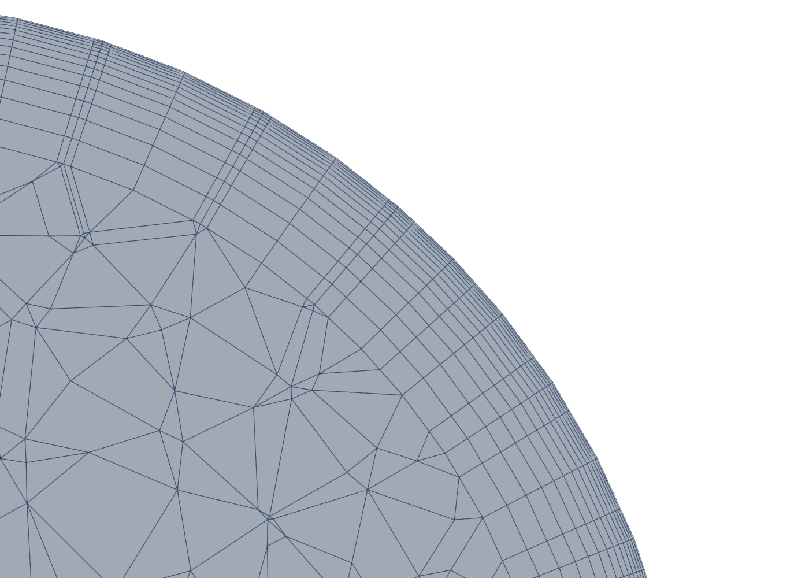

# FluidCraft technical reference

This is the detailed reference: every module and setting, the validation results, building from
source, the command-line tool and the code layout. The [README](../README.md) is the short
introduction, and the [user guide](Guide/index.html) (Help › FluidCraft Guide in the app) explains
how to use it.

FluidCraft is the graphical interface; OpenFOAM is the solver. FluidCraft writes the setup as an
OpenFOAM case, runs it in an installed OpenFOAM and reads the results back into a Metal graphics
window. It adds only what OpenFOAM does not have: the setup pages and their mapping to OpenFOAM
dictionaries, application modules, CAD import and samples, standard initialization (values,
expressions, patches), in-app post-processing, Python post-processing scripts, physics-informed
neural networks and an AI assistant. FluidCraft had its own finite-volume solvers until November
2026; they are kept in the git history (tag `pre-openfoam-only-2026-11-24`).

## What is in it

**Modules** (the category buttons along the top of the window, each a dropdown, and the Module
selector)

| Category | Module | What you configure |
|---|---|---|
| Wind Energy | Wind Farm | rows × turbines, spacing (in D), rotor diameter, hub height, Ct, Cp, hub-height wind, terrain roughness z₀, domain margins, cells per diameter, turbulence model |
| Wind Energy | Wind-Turbine Rotor | radius, blade count, NACA aerofoil, design angle of attack, hub size, wind speed, tip-speed ratio, blade/far cell sizes, domain, turbulence model |
| Electronics Cooling | Air-Cooled Heat Sink | chip power and size, board size/thickness/material, heat-sink footprint, base, fin count/thickness/height, material, duct height, inlet speed and temperature, cell size |
| Electronics Cooling | Liquid Cold Plate | chip power, plate size, channel count/width/height, floor and lid, manifolds, plate material, coolant, inlet speed and temperature, cell size |
| General CFD & CAD | CAD Import & Analysis | your CAD file or one of nine samples, units, analysis type (external aerodynamics, internal flow, conjugate heat sink), flow direction and speed, fluid, solid, heat load, mesher, resolution, prism layers |
| General CFD & CAD | Tutorials & Validation | the textbook cases and the validation suite |
| General CFD & CAD | Custom Case | mesh generation or import, then the Setup and Solution pages |
| Pre & Post-Processing | Pre-Processing | mapFields from another case, setFields regions (box, sphere, cylinder) with field values, applyBoundaryLayer, full checkMesh |
| Pre & Post-Processing | Post-Processing | derived fields (vorticity, Q, λ₂, enstrophy, Courant, Péclet, Mach, wall shear, y⁺, wall heat flux, stream function, flow type, turbulence fields), line samples into the XY plot, iso-surfaces, streamlines, VTK and EnSight export, run after every solve or on demand |
| AI & Machine Learning | Physics-Informed Neural Network | mode (physics / hybrid / surrogate), layers, neurons, activation, Fourier features, Adam epochs, learning rate and decay, L-BFGS, batch sizes, loss weights, energy, device, seed, Python and PyTorch status with Install / Repair |
| AI & Machine Learning | AI Assistant | provider (Anthropic Claude, OpenAI-compatible, local Ollama), model, endpoint, effort, token limit, case summary on/off |

Each module appears once, in one category. Pre- and post-processing run OpenFOAM's own
utilities: `mapFields`, `setFields`, `applyBoundaryLayer`, `<solver> -postProcess`, `foamToVTK`
and `foamToEnsight`. FluidCraft writes their dictionaries and runs them as stages, so what you set
is exactly what OpenFOAM does.

Each case-building module makes the mesh and a complete OpenFOAM-ready setup (Build Case), or
builds and runs it (Build and Run); everything it sets stays editable on the Setup, Solution
and OpenFOAM pages. Module choices and parameters are saved with the case.

**Physics-informed neural networks**: the PINN module writes the open case as a training
problem (cell centres as collocation points; boundary faces with their conditions; optional
samples of the current OpenFOAM solution) plus a PyTorch script, and trains it with a Python
interpreter set in Settings › Machine Learning. Steady incompressible Navier–Stokes and
convection–diffusion of temperature are learned in non-dimensional form. Velocity, pressure,
no-slip and slip walls, outlets, fixed temperature, adiabatic, heat-flux and convection walls
all have loss terms. The prediction is loaded back as a solution, so contours, vectors,
pathlines, reports and XY plots work on it. Fluid regions only (no solid zones yet). "Set Up
PyTorch Environment…" creates `~/FluidCraft/pinn-env` with PyTorch and NumPy when you ask for it. From the command line: `fluidcraft-cli pinn cavity-re100 [--mode hybrid --solve] [--epochs N] [--device cpu|mps]`, or `fluidcraft-cli pinn case.fluidcraft`.

**AI assistant**: questions about the open case go to Claude (`claude-opus-5-5` by default,
Anthropic Messages API with adaptive thinking, selectable effort and server-side refusal
fallback), an OpenAI-compatible endpoint, or a local Ollama model. With "Send case summary" on,
each question carries the setup, boundary and cell-zone conditions, materials, mesh quality,
latest residuals, reports and recent warnings. API keys are kept in the macOS Keychain (or read
from `ANTHROPIC_API_KEY` / `OPENAI_API_KEY`), never in case files.

**Meshing**
- Structured block meshes (2D slabs and 3D, graded segments, rectangular obstacles, box-defined solid/porous cell zones, named patches) and a 2D cylinder O-grid, generated by OpenFOAM's **blockMesh**: FluidCraft cuts the axes into blocks wherever a segment, obstacle, zone box or patch rule changes and writes a `blockMeshDict` whose block gradings reproduce the specified spacing exactly (cell centres within 10⁻⁸); the O-grid is 8 curved blocks with `arc` edges.
- Gmsh workflow (uses `/Applications/Gmsh.app`): channel + cylinder, NACA 4-digit airfoil in a far field with boundary-layer quads, 3D pipe, and **CAD import** for external flow (body subtracted from a box) or internal flow, with inlet/outlet/far-field/wall named selections assigned automatically.
- **CAD formats**: exact B-rep geometry (STEP `.step/.stp`, IGES `.iges/.igs`, OpenCASCADE `.brep`, FreeCAD `.FCStd`, whose visible shapes are extracted from the document and combined) through Gmsh's OpenCASCADE kernel; triangulated surfaces (STL ASCII/binary with one region per `solid`, Wavefront OBJ with groups, PLY ASCII/binary, OFF, 3MF with one region per object, glTF 2.0 `.gltf/.glb` with node transforms and one region per mesh, AMF plain or zipped, VTK legacy polydata) read by FluidCraft, welded, cleaned and oriented. File units m/mm/cm/in/ft (3MF, AMF and glTF declare their own; large models are flagged as probably millimetres). Triangulated surfaces are split into smooth patches at a feature angle, reparametrized and remeshed by Gmsh; surfaces that must bound a volume are checked for open edges first.
- **SolidWorks and SolidCraft:**
  - SolidWorks: export STEP (AP214/AP242), IGES, STL or 3MF and open it directly. Native `.sldprt` and Parasolid files need a converter.
  - SolidCraft: its `.sc` designs open directly. FluidCraft runs SolidCraft's own `solidcraft-cli` to write exact STEP, the same bridge Draftwright uses. Its STEP, 3MF, STL and OBJ exports open too, and Rhino `.3dm` files go through SolidCraft when no other converter is set.
  - Units: the length unit a STEP file declares is used automatically. Files from the bare OpenCASCADE writer (Gmsh) are not trusted, because they always say millimetres.
- **Region to simulate** (CAD Import & Analysis, external flow and the conjugate duct):
  - Domain margins in body lengths: upstream, downstream, beside, below, above.
  - A body standing on the ground: the floor is a wall, optionally moving at the free-stream speed (rolling road), and it is left out of the body forces.
  - A refinement box with its own cell size: a Gmsh Box field, or the snappyHexMesh refinement box.
  - 3D CAD meshes are cleaned with Gmsh's Netgen optimiser.
- **Native CAD formats** (SolidWorks `.sldprt/.sldasm`, CATIA `.CATPart/.CATProduct`, Parasolid `.x_t/.x_b`, Creo/NX `.prt/.asm`, Inventor `.ipt/.iam`, Solid Edge `.par/.psm`, Rhino `.3dm`, ACIS `.sat/.sab`, JT, IFC): their kernels are proprietary and no open reader exists, so FluidCraft runs a converter you configure (Settings › Native CAD formats, `FLUIDCRAFT_CAD_CONVERTER`, or `--converter`), a command with `{input}` and `{output}` placeholders such as CAD Exchanger's `ExchangerConv -i {input} -e {output}`, and meshes the STEP it writes. The command is run directly without a shell, with the placeholders substituted per argument, so a file name can never act as a command. It is read only from preferences, the environment or the command line, and never from case files. Without a converter, FluidCraft explains how to export STEP instead.
- **Internal-flow openings** are found from the geometry: planar caps on the body's bounding box are grown across shared edges; caps at the two ends of the flow direction become `inlet`/`outlet` (`inlet2`… when there are several), and smaller caps on the other sides become extra outlets (`outlet_ymax`, `outlet_zmin`…), so elbows, tees and manifolds get every opening named without any setup. A rectangular duct's side walls are not mistaken for openings because they cover the whole face of the box. This works for STEP/IGES (a coarse probe triangulation finds the caps, then the exact CAD faces are selected), triangulated files and snappyHexMesh.
- **snappyHexMesh meshing of CAD** (needs OpenFOAM): background block sized from the body, `surfaceFeatureExtract`, surface and feature refinement levels, a refinement box around the body and its wake, prism layers (relative or absolute first-layer thickness), mesh-quality limits, `locationInMesh` found automatically with an inside/outside ray test, serial or `mpirun` parallel meshing with `reconstructParMesh`, `checkMesh`, then the polyMesh is imported with each STL solid/OBJ group as its own patch. STEP/IGES are tessellated with Gmsh first, at a size tied to the finest surface level.
- **3D prism boundary layers** on the Gmsh pipe and CAD meshes (and on any imported 3D mesh from the command line): first-layer height, growth rate and number of layers, with a y⁺ calculator that sizes the first layer. FluidCraft writes the Gmsh mesh as a polyMesh and runs **snappyHexMesh's layer addition only** (no castellation or snapping) on its wall patches; the layers slide along inlets, outlets and symmetry planes, and snappyHexMesh reports the thickness reached per patch.

  
  *Cross-section of the turbulent pipe tutorial: 14 graded prism layers added by snappyHexMesh to the Gmsh tetrahedra (half the requested thickness reached, wall y⁺ ≈ 0.5).*
- **CAD Analysis** (Meshing › CAD Analysis, File › Import CAD for Analysis…, `fluidcraft-cli cad-analysis`): choose a CAD file and an analysis type: external aerodynamics (drag, lift), internal flow (pressure drop, flow split) or electronics cooling / heat sink (conjugate). FluidCraft sizes the enclosure and cells from the model, picks laminar or k-ω SST from the Reynolds number, sizes the first prism layer, meshes the model with Gmsh or snappyHexMesh, and sets up materials, boundary conditions, reference values and reports. For heat sinks, the solid and the surrounding air are meshed together with a conformal interface (OpenCASCADE BooleanFragments), and the heat load enters through the solid's lowest face.
- **CAD samples** (File › CAD Samples, `fluidcraft-cli samples`): eight parametric OpenCASCADE models saved as STEP, so each behaves exactly like a file from a CAD system:
  - a sphere
  - an Ahmed body with a 25° slant
  - a NACA 0012 wing at 4°
  - a 90° pipe elbow
  - a mixing tee
  - a 9-fin plate-fin heat sink
  - a twisted and tapered NACA 4412 wind-turbine blade, lofted through six sections
  - a three-blade rotor
- Importers: OpenFOAM's own converters do the work. ASCII Fluent `.msh`/`.cas` files go through `fluentMeshToFoam` (2D meshes extruded with `-2D`, cell zones kept; `fluent3DMeshToFoam` when a 3D mesh has shapes `fluentMeshToFoam` cannot build), and FluidCraft restores Fluent's boundary types (velocity-inlet, pressure-outlet, …) and solid zones from the file's zone sections. 3D Gmsh `.msh` 2.2/4.1 files, including the meshes FluidCraft's Gmsh templates and CAD analysis generate, go through `gmshToFoam`. FluidCraft's own readers remain only for what those converters cannot read: binary Fluent files, binary or 2D Gmsh files (extruded one cell thick), Gmsh files that reuse a physical tag in two dimensions (`gmshToFoam` would mix up their names), and any file when OpenFOAM is not installed. The app and `fluidcraft-cli mesh-info` say which converter read the file. OpenFOAM `polyMesh` (ASCII/binary/gzip) is read directly. Fluent HDF5 (`.cas.h5`) is not supported.
- Exporters: Fluent ASCII `.msh` (one contiguous cell section per zone with per-cell element types, so `fluentMeshToFoam` and Fluent read it), OpenFOAM case (mesh with cell zones, `0/`, `constant/`, `system/`, `Allrun`) for any of the applications below, ParaView `.vtu` (polyhedral cells), CSV.
- Mesh check: Fluent-style orthogonal quality, aspect ratio, non-orthogonality, volume statistics; zone renaming/retyping.

**Case setup** (Fluent vocabulary, written as OpenFOAM dictionaries)
- General: pressure-based or density-based (rhoCentralFoam), steady or transient, gravity, operating conditions.
- Models: laminar, k-ω SST, standard and realizable k-ε, Spalart–Allmaras (more on the OpenFOAM page); energy; passive (user-defined) scalars.
- Materials: constant, Boussinesq, incompressible-ideal-gas and ideal-gas density; constant, power-law and Sutherland viscosity; solids with isotropic or orthotropic conductivity; a material library.
- Cell zones: solid zones (conjugate heat transfer), porous zones (Darcy + inertial), MRF rotating zones, actuator disks, momentum and energy sources (constants or expressions).
- Boundary types: velocity inlet, mass-flow inlet, pressure inlet/outlet with backflow, outflow, wall (stationary/moving/rotating, no-slip/slip, temperature/heat-flux/convection, roughness), symmetry, pressure far field, atmospheric-boundary-layer inlets.
- Named expressions (`4*Umax*y*(H-y)/H^2`, functions of x, y, z, t) anywhere a value is entered.
- Initialization: *standard* (uniform values, expressions of x, y, z, or the values of a boundary zone, plus box/sphere/cylinder patches) is computed by FluidCraft and written as nonuniform `0/` fields, and can be inspected with Initialize before the run; *hybrid* runs OpenFOAM's `potentialFoam` as the first stage (incompressible cases with an inlet).
- Report definitions (surface averages, integrals, mass flow, volume statistics, forces, drag/lift/moment coefficients, heat transfer rate) become OpenFOAM function objects where OpenFOAM has one, and are evaluated by FluidCraft on the loaded results otherwise.

**OpenFOAM** (ESI OpenFOAM v2xxx; built on Chisel's OpenFOAM driver)
- Calculate writes the case, runs it stage by stage (`checkMesh`, `decomposePar`, optional `potentialFoam`, the solver under `mpirun -np N … -parallel`, `reconstructPar`, user stages), streams residuals into the Scaled Residuals plot and report definitions into Report Plots, and loads the latest time back into FluidCraft. Contours, vectors, pathlines, XY plots, reports, VTK export and `.fluidcraft` packages then work on the OpenFOAM solution. Stop terminates the run cleanly.
- Installations are found automatically: the openfoam.com `.app` (its disk image is mounted on demand), a source/Homebrew tree with `etc/bashrc`, or a bundle such as SimFlow's. Cases run in `~/FluidCraft/<title>` by default because OpenFOAM rejects paths with spaces; FluidCraft refuses to clean a non-empty folder that is not an OpenFOAM case.
- Applications: simpleFoam, pimpleFoam, pisoFoam, icoFoam, potentialFoam, buoyantBoussinesqSimpleFoam/PimpleFoam, buoyantSimpleFoam/PimpleFoam, rhoSimpleFoam, rhoPimpleFoam, rhoCentralFoam, chtMultiRegionSimpleFoam/chtMultiRegionFoam, chosen automatically from the setup (steady/transient, energy, Boussinesq/incompressible-ideal-gas/ideal-gas density, density-based, solid zones; LES/DES pick a transient solver) or set by hand.
- **Conjugate heat transfer**: a mesh with solid cell zones is split into one fluid region and one region per solid zone, with each fluid–solid or solid–solid face pair written as `mappedWall` patches and coupled by `turbulentTemperatureRadCoupledMixed`. Solids get `heSolidThermo` from their material, external thermal conditions and volumetric heat sources (constant or expression). The run uses `-allRegions`/`-region` utilities in serial or parallel, and the regions are mapped back onto the FluidCraft mesh, so the temperature field is continuous across fluid and solid for post-processing.
- **Multiple fluids, radiation, rough walls**: each fluid material in a conjugate case becomes its own region, so an air-cooled board and a water cold plate can share one case. Radiation uses fvDOM (discrete ordinates, transparent or participating gas) or P1, with wall emissivity; solid–fluid interfaces exchange radiative flux through `qr`, and the case switches to buoyantSimple/PimpleFoam. Orthotropic solids are written as `constAnIso`. Atmospheric-boundary-layer inlets become `atmBoundaryLayerInlet*`, rough terrain becomes `atmNutkWallFunction` with z₀, and actuator disks become `actuationDiskSource` (Froude, sampling the wind at an upstream point). MRF zones whose patches are not axisymmetric about the rotation axis are flagged.
- **Robust on tetrahedral CAD meshes**:
  - Scalars convected at second order get cell-limited gradients.
  - Meshes with tetrahedra use Green–Gauss gradients. OpenFOAM's least-squares gradient seeds a slow instability in near-wall tetrahedra with two boundary faces.
  - The non-orthogonal correction is limited from 60°, with an extra corrector.
  - Heat-transfer cases get a `limitTemperature` safety net.
- Turbulence: every model on the Models page plus RNG and Launder–Sharma k-ε, Wilcox k-ω, LES (Smagorinsky, WALE, k-equation, dynamic k-equation) and DES/DDES/IDDES (Spalart–Allmaras and k-ω SST), with Spalding, log-law or low-Re wall treatment and the LES filter width.
- Mapped from the FluidCraft setup: materials (constant, power-law, Sutherland viscosity; constant, Boussinesq, incompressible and ideal-gas density), every boundary type including expression profiles (written as nonuniform lists when they vary in space, and as OpenFOAM `exprFixedValue` conditions when they vary in time: velocity, pressure and temperature), moving/rotating/slip walls, temperature, heat-flux and convection walls, turbulence inlet specifications, pressure far field, gravity, porous zones (DarcyForchheimer), momentum and energy sources (fvOptions; expression sources become `exprField` sources evaluated by OpenFOAM at cell centres and time), MRF zones, passive scalars (scalarTransport), reports (forceCoeffs, forces, surfaceFieldValue, volFieldValue), y⁺, wall shear stress, probes, data sampling (fieldAverage), schemes and relaxation. Initial fields come from the Initialization page (standard initialization written as `0/` fields, or potentialFoam for hybrid), the current solution (so a run continues from loaded results), uniform values or potentialFoam; a run can also restart from the latest OpenFOAM time.
- Also on the OpenFOAM page:
  - Run control: start from latest/start time, stop at end time / write now / next write, runTimeModifiable, compression, time precision.
  - A velocity limiter (`limitVelocity`).
  - More function objects: residuals (`solverInfo`), Courant and Mach numbers, pressure coefficient, wall heat flux, turbulence fields, λ₂, and cutting planes written as VTK surfaces.
  - `runTimeControl`, which stops a run when a chosen report settles.
  - **Case Files**: a preview of every generated dictionary and field file, any of which can be replaced by your own text. Replacements are written last and listed for approval when a case is opened from disk.
  - **Periodic patches** (Boundary Conditions › Periodic): any two patches become a `cyclicAMI` pair with a translation (from the patch centroids or given) or a rotation (axis, centre, angle), for matching or non-matching faces. `meanVelocityForce` drives a closed periodic flow.
  - **Baffles** (OpenFOAM page › Baffles and Periodic Flow): fans with a fan curve (Q, Δp), porous jumps (screens, filters, perforated plates: D, I, L) and zero-thickness walls. FluidCraft writes `createBafflesDict`, with the faces cut by a disk, plate or box, and runs OpenFOAM's `createBaffles` before the solve.
- OpenFOAM settings exposed in the app: installation and case directory, application, turbulence and wall treatment, endTime/deltaT overrides, adjustable time step (maxCo, maxDeltaT), write interval/format/precision/purgeWrite, every fvSchemes entry, linear solver/smoother/preconditioner/tolerances per equation group, SIMPLE/PIMPLE/PISO correctors, consistent, momentum predictor, outer-loop residual control, residualControl, relaxation factors, cores and decomposition method, function objects, raw boundary conditions for any field on any patch, text appended to any generated dictionary, extra files (e.g. `topoSetDict`) and custom stages (e.g. `topoSet`, `setFields`, `postProcess`). Every case also gets an `Allrun`/`Allclean` that runs from a terminal. Custom stages may only start OpenFOAM applications (programs in `FOAM_APPBIN`, `FOAM_SITE_APPBIN` or `FOAM_USER_APPBIN`), and their words are quoted, never interpreted by a shell. A case opened from disk that carries stages, raw function objects, dictionary text, raw boundary conditions or extra files lists them and asks for approval before FluidCraft first writes or runs it, because OpenFOAM features such as `systemCall`, `#codeStream` and coded boundary conditions can run programs.
- More OpenFOAM settings, each tested on OpenFOAM v2606 (`FoamSettingsMoreTests`):
  - **Turbulence:** k-ω SST-SAS, SST Langtry–Menter transition (ReThetat, γ), GEKO, the LRR and SSG Reynolds-stress models (R, ε), LES sigma and Deardorff differential stress, plus any model coefficient (`<model>Coeffs`, e.g. Cmu, betaStar, Cs).
  - **Boundary conditions per patch** (OpenFOAM page › Boundary Conditions):
    - Inlets: volumetric flow rate; synthetic LES inflow (turbulentDFSEMInlet, from the intensity, length scale and inflow height); a velocity profile from a CSV file of points (timeVaryingMappedFixedValue, written to `constant/boundaryData`).
    - Inlets and outlets: fan curves (fanPressure).
    - Outlets: non-reflecting (advective, or waveTransmissive for compressible solvers).
    - Walls: sand-grain roughness (nutkRoughWallFunction with Ks and Cs).
  - **Thermophysical models:**
    - Transport: const, Sutherland or polynomial μ(T), κ(T).
    - Thermo: constant Cp, JANAF NASA polynomials (with an air preset) or polynomial Cp(T).
    - Equation of state: perfect gas, incompressible perfect gas, ρ = const, perfect fluid, Peng–Robinson real gas, polynomial ρ(T) or Boussinesq.
    - Combinations OpenFOAM is not compiled for are refused, with a list of the ones it has. The energy form (enthalpy or internal energy) follows what OpenFOAM offers.
  - **fvOptions:** blade-element rotors (rotorDisk: blade sections and an airfoil table), fixed-temperature zones (fixedTemperatureConstraint) and velocity damping (velocityDampingConstraint).
  - **Run control and solvers:** writeControl (time steps, simulated, wall-clock or CPU time), pressure reference point and value, hierarchical/simple decomposition split and order, and the linear-solver extras (minIter, nSweeps, GAMG pre/post sweeps, mergeLevels, cacheAgglomeration).
  - **Time averaging:** fieldAverage with any fields, variance, a start time and a window.
  - **Adaptive mesh refinement** (dynamicRefineFvMesh) of hexahedral meshes in transient runs, on a field or an OpenFOAM expression such as `mag(U)`.
- FluidCraft expressions are translated to OpenFOAM's expression syntax (`x` → `pos().x()`, `t` → `time()`, `^` → `pow`, `if(c,a,b)` → `c ? a : b`, named expressions inlined).

**App**
- Outline tree with task pages for every Setup/Solution/Results node, Metal graphics window (contours smooth or banded, vectors, pathlines, mesh, planes and iso-surfaces, feature-edge outlines, axis triad, five colormaps), scaled-residual and report plots, XY plots, a console with text commands, `.fluidcraft` case packages (case + mesh + data), PNG export with legend, 19 tutorials (meshed with blockMesh or Gmsh, solved with OpenFOAM) and an in-app validation suite. The four engineering tutorials are:
  - **Wind farm:** three 80 m turbines in a row as actuator disks in a 10 m/s atmospheric boundary layer, k-ε with rough ground.
  - **Wind-turbine rotor:** the lofted three-blade rotor in a rotating MRF zone at tip-speed ratio 6, k-ω SST, reporting torque coefficient and thrust.
  - **Air-cooled heat sink:** a 10 W chip on an FR-4 board under an aluminium heat sink in a 2 m/s duct.
  - **Liquid cold plate:** a 100 W chip under a copper plate with four water channels.

## Validation

Every number here is OpenFOAM v2606's solution, meshed and set up by FluidCraft, read back and
measured by FluidCraft's post-processing (`fluidcraft-cli validate …` or the app's Validation Suite, on
an M3 Pro). A pass therefore checks the whole chain: block meshing with blockMesh, Gmsh meshing,
case writing, the OpenFOAM run and reading the fields back.

| Case | Quantity | Reference | Result |
|---|---|---|---|
| Lid-driven cavity Re=100, 64² (simpleFoam) | max \|u − u_Ghia\| / max \|v − v_Ghia\| | Ghia et al. 1982 | 0.0044 / 0.0091 (6 s) |
| Lid-driven cavity Re=1000, 128² | max \|u − u_Ghia\| / max \|v − v_Ghia\| | Ghia et al. 1982 | 0.0044 / 0.0130 (11 s) |
| Natural convection Ra=10⁵, 64² (buoyantBoussinesqSimpleFoam) | Nusselt number, u_max, v_max | 4.519, 34.73, 68.59 (de Vahl Davis 1983) | 4.526 (+0.15 %), 34.83, 68.89 |
| Flat plate, k-ω SST, Re=5×10⁶ | Cf at x = 0.97 | Kármán–Schoenherr 0.00283 | 0.00266 (−6 %, a known property of SST here) |
| Flat plate, Spalart–Allmaras | Cf at x = 0.97 | Kármán–Schoenherr 0.00281 | 0.00275 (−2.1 %) |
| Schäfer–Turek 2D-1 (Gmsh, 35k cells) | C_D / Δp / C_L | 5.57–5.59 / 0.1172–0.1176 / 0.0104–0.0110 | 5.579 / 0.1174 / 0.0085 (see notes) |
| Cylinder Re=100, O-grid (pimpleFoam, 4 outer correctors) | St / C_D mean / C_L amplitude | 0.164–0.166 / 1.33–1.35 / 0.32–0.34 | 0.1645 / 1.338 / 0.325 |
| Sod shock tube, 400 cells (rhoCentralFoam, Kurganov) | L1 density error at t = 0.2 | exact Riemann solution | 0.0019 |
| Mach 2.5, 15° ramp (rhoCentralFoam) | p₂/p₁ | 2.4696 (oblique-shock theory) | 2.4687 |
| Turbulent pipe Re=20 000, SST, Gmsh tetrahedra + 14 snappyHexMesh layers (394k cells, wall y⁺ 0.48) | Darcy f from dp/dx / from wall shear, x/D 5.5–8.5 | Petukhov 0.02615 (pipe not fully developed, see notes) | 0.02539 (−2.9 %) / 0.02394 (−8.5 %) |

OpenFOAM integration tests (`swift test`, each checked against an exact or independent result):

| Case | Quantity | Reference | Result |
|---|---|---|---|
| Composite wall, two solids k = 1 / 4 (chtMultiRegionSimpleFoam) | T profile / heat flux | exact: 400→320→300 K, 160 W/m² | within 0.01 K / 2 % |
| Stagnant fluid slab against a solid (fluid–solid coupling) | T profile / heat flux | exact series resistance | within 0.01 K / 2 % |
| Taylor–Couette with an MRF zone around the rotor | u_θ at r = 0.75, 1.25, 1.6 | exact A r + B/r | within 0.7 % |
| Channel, ideal gas at M ≈ 3·10⁻⁴ (rhoSimpleFoam) | pressure drop | simpleFoam on the same mesh | within 3 %, mass conserved to 10⁻³ |
| Heated ceiling, incompressible ideal gas with gravity (buoyantSimpleFoam) | heat out of the outlet | 0.2 W added at the wall | within 3 % |
| Periodic plane channel (cyclicAMI + meanVelocityForce) | u(y) | exact Poiseuille profile 6Ū y(H−y)/H² | within 2 % of u_max |
| Fan baffle with a flat 0.5 Pa curve (createBaffles, fan) | inlet pressure change | −0.5 Pa | within 0.05 Pa |
| Porous jump, Darcy only, uniformJump (porousBafflePressure) | inlet pressure change | D μ Ū L | within 5 % |
| Heater zone with a source `2e4*(1 + x)` and inlet `0.1*(1 + 10*t)` | inlet mass flow at t = 0.1 | 1.225 × 0.2 × A | within 10⁻³ |

Mesh checks: block meshes reproduce the spec's graded spacing (cell centres within 10⁻⁸), obstacles, patch rules and cell zones; the O-grid fills the annulus; snappyHexMesh layers on a tetrahedral cube keep its volume (to 4·10⁻⁶) with the first layer at the requested height. CAD → snappyHexMesh: an STL sphere (external flow, 3 layers, 4 cores) gives 364k cells with checkMesh OK and 100 % layer coverage; a STEP sudden expansion written in millimetres is snapped and layered to a fluid volume of 2.548 m³ against the exact 2.553 m³. Every CAD format meshes the same sphere to the same domain; internal flow finds every opening of a STEP tee and elbow in Gmsh and snappyHexMesh (tee: checkMesh OK, 98 % layer coverage).

**Engineering tutorials and CAD analysis** (OpenFOAM v2606, re-measured on 25 November 2026 after the switch to OpenFOAM's mesh converters; 4 cores on an M3 Pro). Energy balances are exact references; the rest are cross-checks.

| Case | Quantity | Reference | Result |
|---|---|---|---|
| Liquid cold plate (67 200 hex cells, laminar water, FR-4 board; 2000 iterations, 45 s) | heat into water / Δp / chip T_max | 100 W in | 99.89 W / 37.60 Pa / 342.97 K |
| Air-cooled heat sink (73 968 hex cells, SST; 1500 iterations, 68 s) | heat into air / Δp / chip T_max | 10 W in | 9.998 W / 1.346 Pa / 334.03 K |
| Cooled chip CHT tutorial (3000 iterations, 34 s) | inlet pressure / chip T_max / heat out | 0.2 W in | 0.023266 Pa / 371.83 K / 0.19990 W |
| CAD heat sink sample (Gmsh tetrahedra via gmshToFoam, conjugate, 158k cells) | heat into air / solid T_max | 10 W in | 9.98 W / 309.6 K (checkMesh flags one sliver tetrahedron in the solid, aspect ratio 5800) |
| CAD NACA 0012 wing sample (AR 4, 4°, 49k coarse tetrahedra; snappyHexMesh adds no layers at the sharp trailing edge) | C_L / C_D (planform reference) | lifting-line C_L ≈ 0.29 | 0.138 / 0.085 (coarse mesh under-predicts lift) |
| CAD example `Examples/CAD/manifold.step` (mm), dead-ended header, water 0.5 m/s, SST, 44 698 cells (tetrahedra + 12 snappyHexMesh layers) | branch flow split / mass balance | mass conservation; dividing-manifold trend | 32.1 / 33.1 / 34.8 % (rising toward the closed end); in = out to 2·10⁻⁵ |
| Wind farm, 3 actuator disks, ABL, k-ε | disk-averaged wind speed, turbines 1–3 | 1-D momentum theory: 7.5 m/s at the first disk | 8.08 / 7.68 / 7.51 m/s (converged in 275 iterations, 26 s) |
| Wind-turbine rotor, MRF, SST (197 799 tetrahedra via gmshToFoam) | C_m (C_p = 6 C_m) / thrust | — | 0.0345 (C_p ≈ 0.21) / 102.0 N |
| PINN, lid-driven cavity Re = 100 (physics only, 6×64 tanh, 10 000 Adam + 2000 L-BFGS, CPU, 7.0 min) | max \|u − u_Ghia\| / max \|v − v_Ghia\| | Ghia et al. 1982 | 0.024 / 0.025 |
| PINN, same cavity, hybrid (physics + 4096 OpenFOAM samples, 3000 Adam + 1000 L-BFGS, Apple GPU, 2.3 min with the CFD run) | max \|u − u_Ghia\| / max \|v − v_Ghia\| | Ghia et al. 1982 (the OpenFOAM data itself: 0.0044 / 0.0091) | 0.0059 / 0.0084 |

**Notes on behaviour found during validation**
- Schäfer–Turek lift (1/500 of the drag) is not mesh-converged on unstructured Gmsh meshes: OpenFOAM gives 0.0085, 0.0138, 0.0115, 0.0130 and 0.0105 on meshes of 35k–114k cells while the drag stays at 5.578–5.581. The validation suite checks it only to ±30 %; drag and Δp are the real checks.
- The cylinder wake needs PIMPLE outer correctors at Δt = 0.05 (Courant number above 1 near the cylinder): in PISO mode (1 outer corrector) the lift amplitude came out 0.41, 25 % high, and the mean drag 1.375.
- Hybrid initialization is OpenFOAM's potentialFoam where it applies (incompressible, single region, with an inlet); elsewhere — compressible, thermal or conjugate cases — FluidCraft writes uniform free-stream fields from the inlets, with the far-field speed from its Mach number. Starting the Mach 2.5 ramp from rest made rhoCentralFoam fail.
- Wind farm: OpenFOAM's wakes recover faster than a Jensen engineering wake model, which puts turbine 2 at about 0.88 of turbine 1. That is the known bias of the standard k-ε model, whose eddy viscosity is too high in wakes. The realizable k-ε model or a finer mesh (the module's *cells per diameter*) is the first thing to try.
- Prism layers at sharp edges: snappyHexMesh collapses layers where they would fold (trailing edges, wing tips) and reports the thickness reached per patch; CAD Analysis also checks the face pyramids and keeps the mesh without layers if they fold.
- The 10-diameter turbulent pipe starts from a 1/7-power profile and is not fully developed (wall shear still falls at x/D = 9); compare it with other OpenFOAM runs, not with the fully developed correlations.
- Steady RANS of the 3D mixing tee does not converge (the jet-in-crossflow separation is unsteady), so that tutorial runs transient.
- OpenFOAM's heRhoThermo Boussinesq enthalpy includes p/ρ, so with the benchmark's Cp = 1 a 10 Pa hydrostatic change looks like 10 K and buoyantSimpleFoam diverges. Constant-density and Boussinesq heat transfer therefore use buoyantBoussinesqSimpleFoam/PimpleFoam, which solve temperature directly. Those solvers have no SIMPLEC, so a SIMPLEC setup is written as SIMPLE with OpenFOAM's buoyant-tutorial relaxation (p 0.7, U 0.3, T 0.5).
- rhoCentralFoam is explicit, so FluidCraft always runs it with an adjustable time step: the first step is sized from the smallest cell and the fastest acoustic wave, and maxCo is capped at 0.2 (the OpenFOAM tutorials' value; 0.5 diverged on the ramp). A steady density-based setup runs its iteration count as pseudo-time steps. Supersonic inflow (inlet or far-field Mach ≥ 1) fixes U, p and T at the inflow and extrapolates them at pressure outlets; a far field is specified by Mach number.
- On a square (non-axisymmetric) MRF zone with no moving walls, the exact solution is quiescent, but OpenFOAM shows spurious flow at the zone boundary, a known MRF artefact. MRF zones should be surfaces of revolution, as in the Taylor–Couette check.
- Steady heat-transfer cases use PBiCGStab/DILU for the energy equation and relax it to 0.7 at most. With smoothSolver, the diffusion-dominated first iteration of a heated channel did not converge, and the density collapsed.
- The residuals plotted are OpenFOAM's initial residuals (what residualControl judges), mapped onto FluidCraft's equation names.

## Build and install

Requirements: macOS 15+, Xcode 16+ (Swift 6) to build, and these programs at run time. **Settings › Tools** in the app shows whether each is installed (path and version), opens its download page, copies its Terminal command, and installs it with Homebrew on request (it asks first and shows the output):

| Tool | Needed for | Homebrew command |
|---|---|---|
| OpenFOAM (ESI, v2406 or newer; the macOS `.app` from [gerlero/openfoam-app](https://github.com/gerlero/openfoam-app), about 1 GB, or any tree with `etc/bashrc`) | required: every solve, blockMesh, snappyHexMesh, potentialFoam, mesh conversion | `brew install gerlero/openfoam/openfoam` |
| Gmsh | required for the Gmsh templates, CAD import and CAD analysis | `brew install gmsh` (or Gmsh.app from gmsh.info; any path can be chosen in Settings › Tools) |
| ParaView | optional: *Open OpenFOAM Case in ParaView* | `brew install --cask paraview` |
| Python 3 with NumPy | optional: Python post-processing scripts; PyTorch for PINNs is installed from Settings › Machine Learning | `brew install python numpy` |
| Homebrew | optional: the one-click installs above | from [brew.sh](https://brew.sh) in Terminal (it asks for your password) |

Without OpenFOAM, FluidCraft can still set up cases, import and inspect meshes (with its own readers), mesh with Gmsh and write OpenFOAM cases to run elsewhere.

```bash
Scripts/build-app.sh            # → dist/FluidCraft.app (release, ad-hoc signed)
Scripts/build-app.sh install    # also copies it to /Applications
swift test -c release           # unit tests; the OpenFOAM tests are skipped without an installation
```

The app icon is drawn by `Scripts/make-icon.swift` (`Assets/AppIcon.icns`). The bundle is ad-hoc signed for this Mac; distributing it to others needs a Developer ID signature and notarization.

## Command line

The CLI ships inside the bundle at `FluidCraft.app/Contents/Helpers/fluidcraft` (and as `.build/release/fluidcraft-cli`).

```bash
fluidcraft-cli tutorial flat-plate --cores 4 --vtu plate.vtu                    # mesh (blockMesh), solve (OpenFOAM), export
fluidcraft-cli validate cavity-1000                                            # a benchmark, solved with OpenFOAM and compared
fluidcraft-cli validate all --cores 4
fluidcraft-cli run case.json --mesh mesh.msh --save result.fluidcraft --vtu result.vtu
fluidcraft-cli run result.fluidcraft --continue --iterations 500
fluidcraft-cli run case.json --mesh mesh.msh --app pimpleFoam --dir ~/FluidCraft/run1 --write-only
fluidcraft-cli run --tutorial cht-chip --cores 4                                # conjugate heat transfer (chtMultiRegionSimpleFoam)
fluidcraft-cli mesh-cad part.step --axis 0 --max-size 0.2 --wall-size 0.02 --bl-first 2e-4 --bl-growth 1.2 --bl-layers 12
fluidcraft-cli mesh-pipe --bl-first 2e-4 --bl-layers 8 --foam ./checkCase        # Gmsh tetrahedra + snappyHexMesh layers
fluidcraft-cli validate pipe --re 20000 --cores 4                               # turbulent friction factor on prism layers
fluidcraft-cli run Examples/schafer-turek-3d/case.json --mesh channel.msh --bl-first 0.001 --bl-layers 8 --bl-zones cylinder
fluidcraft-cli export result.fluidcraft --foam ./foamCase
fluidcraft-cli mesh-cad part.stl --unit mm --internal --bl-first 1e-4 --bl-layers 8        # STL/OBJ/PLY/OFF/3MF through Gmsh
fluidcraft-cli foam detect                                                             # OpenFOAM installations
fluidcraft-cli foam mesh body.step --unit mm --levels 3,5 --layers 5 --cores 8 --save body.fluidcraft   # snappyHexMesh
fluidcraft-cli run body.fluidcraft --turbulence kOmegaSST --cores 8 --iterations 1000 --save result.fluidcraft
fluidcraft-cli samples                                                                 # build the CAD samples as STEP in ~/FluidCraft/samples
fluidcraft-cli cad-analysis sample:heatSink --level coarse --run --cores 4             # CAD → mesh → case → run
fluidcraft-cli cad-analysis part.step --type external --axis 0 --speed 30 --unit mm --run       # drag and lift of your own model
FLUIDCRAFT_CAD_CONVERTER="ExchangerConv -i {input} -e {output}" fluidcraft-cli mesh-cad part.sldprt --internal   # native CAD via a converter
```

Case files are JSON (`CaseSetup`); any field may be omitted and takes the Fluent-like default. Minimal example:

```json
{
  "title": "channel",
  "models": { "viscous": "k-omega-sst" },
  "boundaries": {
    "inlet":  { "type": "velocity-inlet", "velocityMagnitude": 2.0, "turbulentIntensity": 0.05 },
    "outlet": { "type": "pressure-outlet" }
  },
  "run": { "iterations": 800 }
}
```

Case JSON can carry an `"openfoam"` object with any `FoamSettings` key, e.g. `{"openfoam": {"cores": 8, "turbulence": "kOmegaSSTDDES", "schemes": {"divU": "Gauss LUST grad(U)"}}}`.

**Python post-processing** (Post-Processing › Python scripts, `fluidcraft-cli post-script`). OpenFOAM computes derived fields, samples and expression fields; free-form analysis of a finished solution is what it has no interface for. FluidCraft exports a time directory of any single-region OpenFOAM case as NumPy arrays and runs your script with the `fluidcraft_post` module:

```python
import numpy as np
import fluidcraft_post as cp

case = cp.load()                         # time, cells (centres, volumes), every volume field
U, p = case["U"], case.pressure_pa()     # (n, 3) and (n,) arrays; pressure in Pa
inlet = case.patches["inlet"]            # face centres, area vectors, field values on faces
cp.report("inlet flow", -inlet.flux("U"), "m3/s")          # shown in FluidCraft
s, u = case.line([0.5, 0, 0], [0.5, 1, 0], n=200, field="U")
forces = case.function_object("forceCoeffs")                 # postProcessing/ output as arrays
case.write_field("speed", np.linalg.norm(U, axis=1))          # new field for ParaView and FluidCraft
cp.savefig("profile")                                         # Matplotlib figure shown in FluidCraft
```

- **Templates:** patch summary, pressure drop, a line plot, a total-pressure field, the residual history and field statistics.
- **Where it runs:** scripts run with the Python from Settings › Machine Learning (the PyTorch environment has NumPy and Matplotlib), in isolated mode and never through a shell. A script can run on demand, or after each solve once the case content is approved.
- **Safety:** scripts saved in a case are listed for approval like any other active content. `fluidcraft-cli post-script case.fluidcraft` needs `--trust-case-content`.
- **Check:** on the Re = 1000 cavity, a script's vertical-centreline minimum u is −0.3837, against −0.3829 from Ghia et al. (1982).

```bash
fluidcraft-cli post-script --case ~/FluidCraft/run1 --script Examples/post-scripts/analysis.py [--time 500]
fluidcraft-cli post-script result.fluidcraft --name pressure_drop --trust-case-content
fluidcraft-cli post-script --templates
```

The app console accepts text commands (`help` lists them), e.g. `/tutorial cavity`, `/solve/iterate 500`, `/display/contour pressure`, `/report/forces`, `/surface/plane mid z 0.5`, `/plot/xy temperature 0 0 0 1 0 0`, `/file/write-case ~/case.fluidcraft`, `/openfoam/set cores 8`, `/openfoam/run`, `/mesh/cad ~/part.step snappy unit=mm`. Setting `FLUIDCRAFT_SCRIPT="cmd1; cmd2"` runs commands at launch.

## Layout

```
Sources/FluidCraftMesh     mesh data structure, geometry, quality, file probes, fallback readers, writers, block-mesh
                       specs, Gmsh driver, CAD import
Sources/FluidCraftSolver   case model, solution object (loaded fields, gradients, wall quantities), initial fields, reports
Sources/FluidCraftPost     surfaces, node interpolation, planes/iso-surfaces, vectors, pathlines, VTK/CSV export
Sources/FluidCraftFoam     OpenFOAM: discovery, case writer, staged runner, log parser, field reader, blockMesh and
                       snappyHexMesh meshing, mesh conversion (fluentMeshToFoam, gmshToFoam), external tools
                       (detection, Homebrew installs), tutorials, benchmarks, validation suite, modules, PINN,
                       Python post-processing
Sources/FluidCraftApp      SwiftUI app and Metal renderer
Sources/FluidCraftCLI      batch interface
Tests/FluidCraftTests      unit, round-trip and OpenFOAM integration tests
```

## Compared with Ansys Fluent

FluidCraft is a front end: the physics FluidCraft can run is the physics OpenFOAM has *and* FluidCraft has a
setup page for. [OpenFOAM-coverage.md](OpenFOAM-coverage.md) lists what the installed OpenFOAM offers that FluidCraft
does not set up yet. The main gaps against Fluent, grouped by area:

**Physics not set up by FluidCraft** (most of it exists in OpenFOAM)
- Multiphase: VOF (interFoam), mixture/drift flux, Eulerian (multiphaseEulerFoam), cavitation, wall films.
- Discrete phase (particle tracking, sprays, erosion).
- Species transport and combustion (reactingFoam, XiFoam, fireFoam), pollutants.
- Surface-to-surface radiation (view factors), Rosseland, solar load. (DO and P-1 are set up.)
- Turbulence: Fluent's SBES, k-kl-ω and enhanced wall treatment have no direct OpenFOAM counterpart; transition (Langtry–Menter), Reynolds-stress models, LES and DES are set up.
- Solidification/melting, batteries, electrochemistry, aeroacoustics, fluid–structure coupling, shell conduction.

**Mesh and motion**
- Fluent Meshing (watertight and fault-tolerant workflows, surface wrapping, poly-hexcore/mosaic meshes). FluidCraft uses blockMesh, snappyHexMesh and Gmsh. Prism layers are snappyHexMesh's, which can leave gaps at sharp concave corners where Fluent collides layers.
- Polyhedral conversion, sliding mesh, overset, 6-DOF and dynamic layering: OpenFOAM has them (cyclicAMI, overPimpleDyMFoam, sixDoFRigidBodyMotion); FluidCraft sets up only adaptive refinement and cyclicAMI periodicity.

**Solver numerics**
- Fluent's coupled pressure-based solver, pseudo-transient and FMG initialization have no OpenFOAM equivalent; OpenFOAM's segregated SIMPLE/PIMPLE/PISO and the density-based rhoCentralFoam are what FluidCraft drives.

**Scale and performance**
- OpenFOAM runs in parallel with MPI (`--cores`), on one Mac here; clusters are possible by exporting the case. Fluent's multi-GPU solver has no counterpart (OpenFOAM is CPU-only).

**Customisation, automation and post-processing**
- UDFs and PyFluent: FluidCraft has JSON cases, a CLI, console commands, Python post-processing scripts, OpenFOAM coded conditions through raw dictionary text, and custom OpenFOAM stages.
- Parametric studies and design points, adjoint optimisation, reduced-order models, Workbench coupling.

**Pedigree**
- Fluent has industrial validation across many sectors. The solver here is OpenFOAM, which is widely validated; FluidCraft's own contribution is checked by the benchmarks above.
