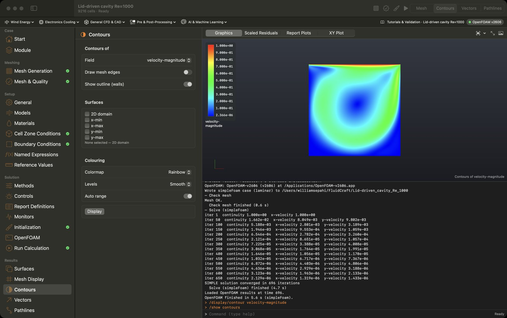
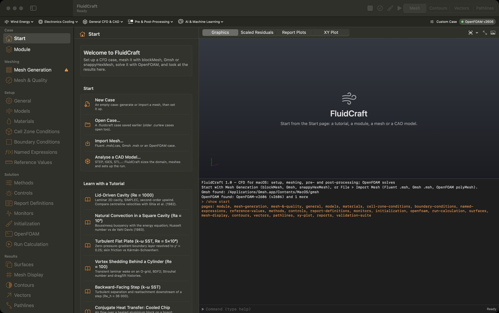

# FluidCraft

**Computational fluid dynamics for the Mac.** Set up a flow or heat-transfer case, mesh it,
solve it with OpenFOAM and look at the results, all in one native macOS app.



FluidCraft is the interface; [OpenFOAM](https://www.openfoam.com) is the solver. You work through
a familiar Mesh → Setup → Solution → Results sequence; FluidCraft writes the case for OpenFOAM,
runs it on your Mac's cores and reads the results back into its own graphics. Meshes come from
OpenFOAM's blockMesh and snappyHexMesh and from Gmsh, including meshes of your own CAD models.

FluidCraft is free and open source under the GNU GPL v3.

## Download

**[Download FluidCraft for Mac](https://github.com/perseus-sepahi/fluidcraft/releases/latest/download/FluidCraft.dmg)**:
macOS 15 or later, Apple silicon, signed and notarized. Open the disk image and drag FluidCraft
to Applications.

FluidCraft needs **OpenFOAM** and **Gmsh** to solve and mesh. On first launch the Start page says
whether they are installed, and **Settings › Tools** installs them with one click (through
Homebrew), or shows where to download them.

## What it does

- **Modules for common jobs**: wind farms with actuator disks, a wind-turbine rotor, an
  air-cooled heat sink and a liquid cold plate (conjugate heat transfer), and CAD analysis that
  takes a STEP, IGES or STL model, sizes the domain, meshes it and sets up the run.
- **A full setup** when you build your own case: laminar and turbulent flow (k-ε, k-ω SST,
  Spalart–Allmaras, LES/DES), heat transfer and buoyancy, compressible and supersonic flow,
  solid and porous zones, rotating zones, periodic boundaries, expressions of x, y, z and t.
- **Meshing** with blockMesh, Gmsh and snappyHexMesh, prism layers sized from a y⁺ target, and
  import of Fluent, Gmsh and OpenFOAM meshes through OpenFOAM's own converters.
- **Results** in the app: contours, vectors, pathlines, cut planes, XY plots, forces and flow
  reports, plus one-click export to ParaView.
- **Python scripts** for your own post-processing, **physics-informed neural networks**
  (PyTorch), and an optional **AI assistant** for questions about the open case.
- **Tutorials and a validation suite** that solve published benchmarks and compare the results.



## Checked against published results

Every number is OpenFOAM's solution, set up and read back by FluidCraft:

| Case | Result | Reference |
|---|---|---|
| Lid-driven cavity, Re = 100 | centreline velocities within 0.0044 / 0.0091 | Ghia et al. 1982 |
| Natural convection, Ra = 10⁵ | Nusselt number 4.526 | 4.519 (de Vahl Davis 1983) |
| Turbulent flat plate, Spalart–Allmaras | skin friction −2.1 % | Kármán–Schoenherr |
| Cylinder wake, Re = 100 | Strouhal number 0.1645 | 0.164–0.166 |
| Mach 2.5 flow over a 15° ramp | pressure ratio 2.4687 | 2.4696 (oblique-shock theory) |
| Liquid-cooled chip | 99.89 W carried away of 100 W in | energy balance |

The full tables, with the meshes and settings used, are in the [technical reference](Docs/Technical.md#validation).

## Privacy

FluidCraft has no accounts, analytics or server of its own, and your cases stay on your Mac. It
connects to the internet only when you ask it to: installing tools with Homebrew, or sending a
question to the AI provider you chose in Settings › AI (with a summary of the open case if you
leave that on). A local model through Ollama keeps even that on your Mac. Full policy:
[perseus-sepahi.github.io/software/fluidcraft/privacy](https://perseus-sepahi.github.io/software/fluidcraft/privacy/).

## Help and support

- In the app: **Help › FluidCraft Guide** (also in [Docs/Guide](Docs/Guide/index.html)).
- Bugs and requests: [GitHub issues](https://github.com/perseus-sepahi/fluidcraft/issues).
- Support page: [perseus-sepahi.github.io/software/fluidcraft/support](https://perseus-sepahi.github.io/software/fluidcraft/support/).

## Building from source

Requires macOS 15 and Xcode 16 (Swift 6).

```bash
Scripts/build-app.sh            # dist/FluidCraft.app, signed for this Mac only
Scripts/build-app.sh install    # also copies it to /Applications
swift build -c release -Xswiftc -enable-testing --build-tests
swift test -c release -Xswiftc -enable-testing --skip-build   # OpenFOAM tests skip without OpenFOAM
```

The [technical reference](Docs/Technical.md) covers every module and setting, the command-line
tool (`FluidCraft.app/Contents/Helpers/fluidcraft`), the code layout and a comparison with
Ansys Fluent.

## Licence and credits

FluidCraft is by Perseus Sepahi and is released under the [GNU General Public License v3](LICENSE).
It runs OpenFOAM, Gmsh and other programs that you install separately; see
[THIRD-PARTY-NOTICES.md](THIRD-PARTY-NOTICES.md).

FluidCraft was called Curlew until November 2026. Cases saved as `.curlew` still open, and the
old app's settings are carried over on first launch.

OPENFOAM® is a registered trade mark of OpenCFD Limited, producer and distributor of the OpenFOAM
software via www.openfoam.com. FluidCraft is not approved or endorsed by OpenCFD Limited. Ansys
and Fluent are trademarks of ANSYS, Inc.; FluidCraft is not affiliated with ANSYS, Inc.
